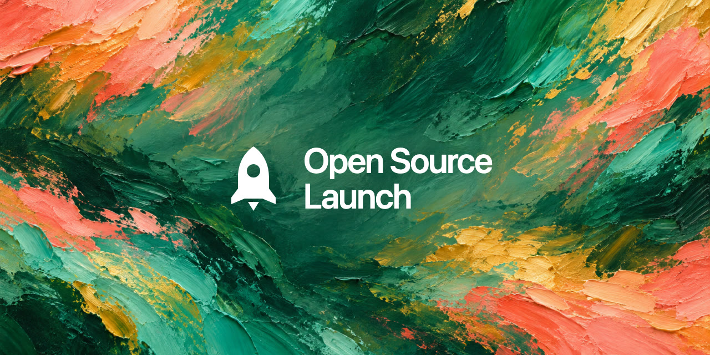

<div align="center">

# Open Source Launch

**一个 Agent Skill：把本地或私有项目变成公开 GitHub 仓库——陌生人装得上，他们的 AI Agent 用得来，搜索引擎找得到。**

隐私检查、干净环境安装验证、Agent 套件（`AGENTS.md` + 内置 Skill）、能转化的 README、SEO/GEO 元数据、油画风社交预览图，再加推广草稿。支持 Claude Code、Codex 以及任何兼容 `SKILL.md` 的 Agent。

[](https://github.com/risingjerry/open-source-launch/actions/workflows/test.yml)
[](https://github.com/risingjerry/open-source-launch/releases)
[](LICENSE)
[](https://github.com/risingjerry/open-source-launch/stargazers)

[English](README.md) · 简体中文



</div>

## 为什么做这个

把仓库设成公开，不等于发布了一个开源项目。很多"公开"仓库只能在作者自己电脑上跑，提交历史里留着本机路径甚至密钥；越来越多的人会直接对 AI 说"帮我装一下这个"，而这些仓库对 AI 来说根本无从下手。

Open Source Launch 让你的 Agent 只做一件事，追求三个结果：

1. **在哪都能跑**——不依赖你电脑上的任何东西，用临时 `HOME` 重新克隆一遍来证明。
2. **任何 Agent 都能接手**——仓库自带给 Agent 的说明书（`AGENTS.md`、`CLAUDE.md`、内置的 `skills/<name>/SKILL.md`、JSON 输出、安全的默认行为）。
3. **别人找得到**——描述和标签里有大家会搜的词，FAQ 标题就是大家会问搜索引擎或 AI 的原话，分享链接时还有一张好看的预览图。

它按这三个结果来判断项目，而不是套一张固定清单：一个小命令行工具要做的，只是桌面应用的一小部分。

## 安装

```bash
npx skills add risingjerry/open-source-launch
```

也可以把 [`skills/open-source-launch/`](skills/open-source-launch) 复制到 `~/.claude/skills/`（Claude Code）或 `~/.agents/skills/`（Codex 等）。装好后开一个新会话，Agent 才能发现它。

## 怎么用

直接对你的 Agent 说：

```text
按开源发布标准检查一下这个仓库，先别改任何东西。
```

```text
把这个项目变成公开仓库：做隐私检查，让它在别人电脑上也能跑，加上 Agent 套件，写好 README，然后改成公开。
```

```text
把我们已经公开的仓库按发布标准翻新一遍，再起草一条 X 帖子。
```

它会按这个顺序做：

| 步骤 | Agent 做什么 | 是否硬性拦截 |
| --- | --- | --- |
| 1. 隐私检查 | 运行内置审计脚本（可选 Gitleaks），看提交历史、图片和 Agent 说明文件 | **是** |
| 2. 可移植 | 找出绝对路径和只存在于本机的状态，用干净克隆证明能装 | **是**（必须真能用） |
| 3. Agent 就绪 | 加 `AGENTS.md`、`CLAUDE.md`、内置 Skill、JSON / 退出码，README 加 Agent 使用段 | 否 |
| 4. README | 一屏完成转化：结果、演示、安装、第一个结果、FAQ、求 star | 否 |
| 5. 可被发现 | 描述、约 14 个标签、问句式 FAQ、油画风社交预览图 | 否 |
| 6. 发布闸门 | 先给你看一张证据表，再改成公开，并读回线上状态核对 | — |
| 7. 推广包 | 起草帖子，列出 awesome 合集清单和各自的真实投稿规则 | 只写草稿 |

发帖、投稿合集、发布软件包、改写提交历史，每一项都要你单独点头——Skill 只起草，从不替你发出去。

## 里面有什么

```text
skills/open-source-launch/
├── SKILL.md                         # 工作流程
├── agents/openai.yaml               # Codex 展示信息
├── scripts/
│   ├── audit_open_source.py         # 隐私 / 打包 / Agent 套件审计
│   ├── social_preview.py            # 1280×640 油画风社交预览图生成
│   └── install_repository_pulse.py  # 可选的仓库数据图表
├── references/
│   ├── agent-ready.md               # 怎么写 AGENTS.md 和内置 Skill
│   ├── portability-contract.md
│   ├── discovery-contract.md        # SEO / GEO / 社交预览
│   ├── adoption-contract.md         # 推广渠道
│   ├── repository-pulse.md
│   └── owner-defaults.example.md    # 复制成 owner-defaults.md，写你自己的风格
└── tests/
```

**你自己的默认设置**：把 `references/owner-defaults.example.md` 复制成 `owner-defaults.md`，填上你的 GitHub 账号、提交身份、视觉风格和推广规则。Skill 会先读它。这份文件不要放进任何公开副本。

### 审计脚本

只用 Python 标准库，只报告位置，从不输出匹配到的密钥：

```bash
python3 skills/open-source-launch/scripts/audit_open_source.py . --json
python3 skills/open-source-launch/scripts/audit_open_source.py . --run-gitleaks --strict
```

它检查基础打包文件、像密钥的内容、被提交的环境变量文件、本机专属引用、有风险的产物、指向仓库外的符号链接、运行时声明、Git 状态，以及有没有 `AGENTS.md` / `CLAUDE.md`。扫描干净只是第一道关，不代表"可以发布"。

### 社交预览图生成

```bash
python3 skills/open-source-launch/scripts/social_preview.py \
  --background bg.png --icon icon.svg --name "Product|Agent CLI" \
  --out docs/social-preview.jpg
```

先用任意生图模型生成一张没有文字的油画背景（提示词在 `owner-defaults.example.md`），脚本会把白色图标和名字放在画面中间的正方形里，聊天软件把预览裁成正方形时也能完整显示。需要 Google Chrome 或 Chromium。

## 运行要求

- 能加载 `SKILL.md` 的 Agent（Claude Code、Codex、Cursor 等）。
- 辅助脚本需要 Python 3.10+ 和 `git`。
- 可选：`gh`（读写 GitHub）、Gitleaks（扫描历史）、Chrome（社交预览图）、Node.js（`npx skills add`）。
- 不收集任何数据。

## 常见问题

### 怎么安全地把 GitHub 仓库改成公开？

先做隐私检查：内置审计脚本，再加上人工过一遍 `git log -p`、截图和 Agent 说明文件。如果历史里有私人信息，Skill 会停下来问你：是改写历史，还是新建一个只有一次提交的公开仓库。它绝不会悄悄改写。

### 怎么让 Claude Code 或 Codex 会用我的仓库？

放一个 `AGENTS.md`（怎么装、怎么测、怎么调用、什么不能做），一个只有一行 `@AGENTS.md` 的 `CLAUDE.md`，再加一个内置的 `skills/<name>/SKILL.md`。Skill 会帮你写好；写法见 [`agent-ready.md`](skills/open-source-launch/references/agent-ready.md)。

### 怎么让搜索引擎和 AI 搜到我的 GitHub 项目？

仓库名和描述用大家真会搜的词，加上聚焦的标签，FAQ 标题写成真实的问题，再设置社交预览图。详见 [`discovery-contract.md`](skills/open-source-launch/references/discovery-contract.md)。

### 它会不经同意就发布东西吗？

你说了"变成公开仓库"，就包括改公开这一步，除非你要求先过目。发帖、投稿合集、发布软件包、改写历史都只起草。

### 只能在 macOS 上跑的应用也能用吗？

能。它不会假装跨平台：平台要求会写在 README 第一屏。

## 卸载

```bash
npx skills remove open-source-launch
```

或者直接删掉 skills 目录里的 `open-source-launch` 文件夹。

## 开发

```bash
python3 -m unittest discover -s skills/open-source-launch/tests -v
python3 -m compileall -q skills/open-source-launch
python3 skills/open-source-launch/scripts/audit_open_source.py . --strict
```

见 [CONTRIBUTING.md](CONTRIBUTING.md)。安全问题请走[私密漏洞报告](https://github.com/risingjerry/open-source-launch/security/advisories/new)，不要开公开 issue。MIT 许可。

## 仓库动态

[](https://github.com/risingjerry/open-source-launch)

---

如果它帮你把项目发出去了，点个 ⭐ 能让更多人找到它。

[](https://star-history.com/#risingjerry/open-source-launch&Date)
